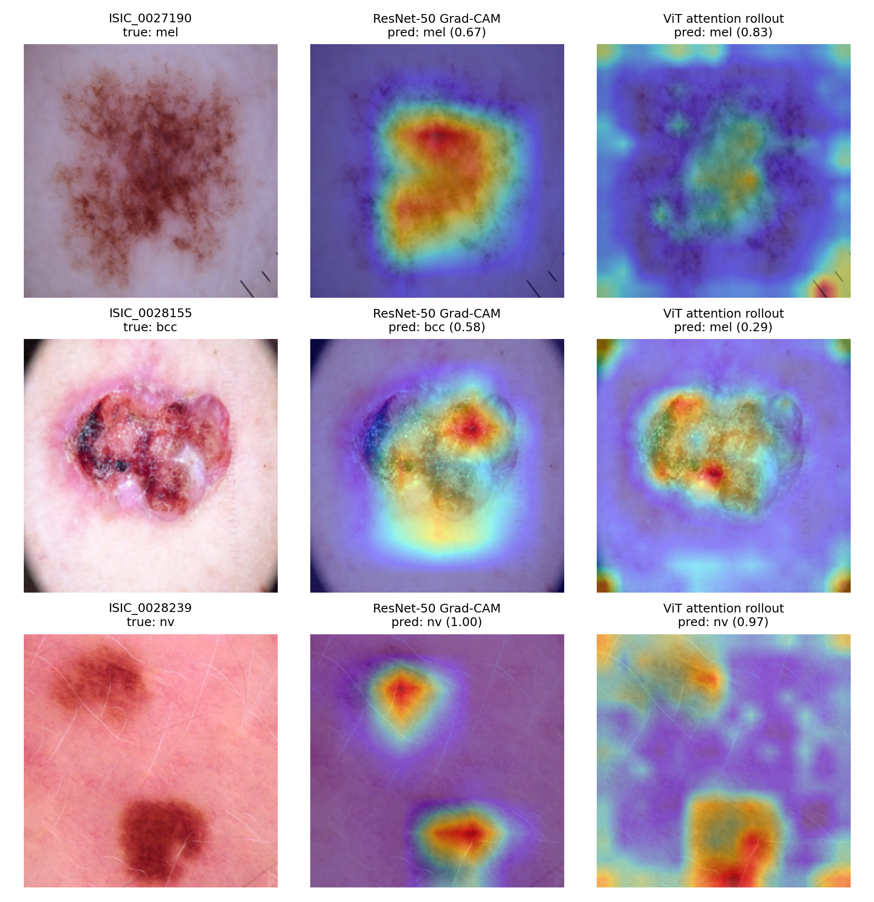

# ResNet-50 vs ViT-Base for skin lesion classification (HAM10000)

I fine-tuned two ImageNet-pretrained models, a CNN ([ResNet-50](https://arxiv.org/abs/1512.03385)) and a Vision Transformer ([ViT-Base/16](https://arxiv.org/abs/2010.11929)), to classify dermatoscopic images from [HAM10000](https://doi.org/10.1038/sdata.2018.161) into 7 diagnostic classes. Training was done on a MacBook Air (Apple M5, 16 GB) with PyTorch's MPS backend. The focus is a sound evaluation: a lesion-level split, imbalance-aware metrics, and a test set used only once.

## Results

Test set: 1,441 images of lesions never seen during training or model selection.

| Model | Test accuracy | Test balanced accuracy [95% CI] | Macro F1 | Training time / epoch |
|---|---|---|---|---|
| Always predict the majority class (nv) | 0.676 | 0.143 | – | – |
| ResNet-50 (best epoch 4/5) | 0.773 | 0.706 [0.648, 0.764] | 0.607 | 3.2 min |
| ViT-Base/16 (best epoch 3/5) | 0.745 | 0.728 [0.670, 0.784] | 0.610 | 8.2 min |

Per-class recall on the test set (number of test images in brackets):

| Class | ResNet-50 | ViT-Base/16 |
|---|---|---|
| akiec – actinic keratosis (34) | 0.765 | 0.765 |
| bcc – basal cell carcinoma (89) | 0.820 | 0.674 |
| bkl – benign keratosis (168) | 0.500 | 0.583 |
| df – dermatofibroma (9) | 0.556 | 0.667 |
| mel – melanoma (146) | 0.493 | 0.616 |
| nv – melanocytic nevus (974) | 0.856 | 0.793 |
| vasc – vascular lesion (21) | 0.952 | 1.000 |

- Both models are far above the majority-class baseline in balanced accuracy. In plain accuracy they are only 7–10 points above it, because the class-weighted loss trades accuracy on the dominant nv class for recall on the rare classes.
- **Neither model is reliably better.** The balanced-accuracy difference (ResNet-50 minus ViT) is −0.022, with a 95% paired bootstrap CI of −0.088 to +0.048, which includes zero.
- ResNet-50 trains about 2.6× faster per epoch.
- Melanoma is the weak point of both models. ViT finds more melanomas (90 vs 72 of 146) but also labels about twice as many nevi as melanoma (143 vs 72).
- Dermatofibroma has only 9 test images, so its recall is not a reliable estimate.

Confusion matrices: [`results/resnet50_confusion_test.png`](results/resnet50_confusion_test.png), [`results/vit_confusion_test.png`](results/vit_confusion_test.png)

### Explanation maps



Grad-CAM ([Selvaraju et al., 2017](https://arxiv.org/abs/1610.02391)) for ResNet-50 and attention rollout ([Abnar & Zuidema, 2020](https://arxiv.org/abs/2005.00928)) for ViT, on the first test image of three classes. ResNet-50's maps lie mostly on the lesion. ViT's are more diffuse and also highlight image corners and ruler marks. Three images cannot show whether that reflects reliance on artefacts or a property of the method, and none of this shows that either model uses clinically meaningful features.

## Method

- **Lesion-level split.** Many lesions were photographed more than once. Images are split into train / validation / test (7,126 / 1,448 / 1,441) with `StratifiedGroupKFold`, grouped by `lesion_id` and stratified by diagnosis, so no lesion appears in two sets. The split is saved in [`splits/ham10000_split.csv`](splits/ham10000_split.csv).
- **Class imbalance.** About 67% of images are nevi. Training uses inverse-frequency class weights in the cross-entropy loss, plus augmentation (random resized crop, flips, rotation, mild colour jitter).
- **Training.** Both models are fine-tuned end to end for 5 epochs with AdamW and a cosine learning-rate schedule (lr 1e-4 for ResNet-50, 2e-5 for ViT), batch size 32. The epoch with the best validation balanced accuracy is kept.
- **Evaluation.** The test set is evaluated once, with that checkpoint. The 95% confidence intervals are bootstrap intervals over test images.

## Reproducing the results

Requires Python 3.9+. On an M5 MacBook Air the full training run takes a little over an hour.

```bash
python3 -m venv venv && source venv/bin/activate
pip install -r requirements.txt
```

**Data.** Download HAM10000 from the [Harvard Dataverse](https://doi.org/10.7910/DVN/DBW86T) or [Kaggle](https://www.kaggle.com/datasets/kmader/skin-cancer-mnist-ham10000) and arrange it as:
```
data/HAM10000_metadata.csv
data/all_images/ISIC_xxxxxxx.jpg      # all 10,015 images in one folder
```

**Pretrained weights.**
- ViT: put `config.json`, `preprocessor_config.json` and `model.safetensors` from [`google/vit-base-patch16-224`](https://huggingface.co/google/vit-base-patch16-224) in `models/vit-local/`. Without that folder, the script downloads them from Hugging Face.
- ResNet-50: torchvision downloads the weights automatically on the first run.

**Run.**
```bash
python3 scripts/download_data.py   # checks that the data and weights are in place
python3 scripts/train_models.py    # trains and evaluates both models, writes results/
python3 scripts/visualize.py       # explanation maps -> supplementary/attention_map.png
latexmk -pdf main.tex              # report; all numbers are read from results/
```

MPS training is not fully deterministic, so a rerun can give slightly different numbers.

## Project structure

|Path |Contents|
|---|---|
| scripts/common.py | split, dataset, transforms, model builders |
| scripts/train_models.py | training, evaluation, result tables |
| scripts/visualize.py | Grad-CAM and attention rollout |
| scripts/download_data.py | setup check |
| splits/ | the lesion-level split used for all results | 
| results/ | metrics (JSON), training history, confusion matrices, tables |
| main.tex, sec/ | report |


## Limitations

- One run, one seed, one split, 5 epochs, no hyperparameter search. The comparison could change with a larger training budget.
- Rare classes have few test images (9 for df, 21 for vasc).
- HAM10000 comes from two clinical sites and does not represent all skin types or imaging devices. These results say nothing about clinical use.

## Revision note

The first version of this project (January 2026, on an Apple M4) trained each model for one epoch on all images, with no held-out data, and reported only the training loss. Its README claimed high accuracy without any measurement, and its "attention map" was a placeholder graphic, not computed from a model. Everything above replaces that version.

## Data licence

HAM10000 is released under CC BY-NC 4.0 by [Tschandl, Rosendahl & Kittler (2018)](https://doi.org/10.1038/sdata.2018.161). The images are not included in this repository.
